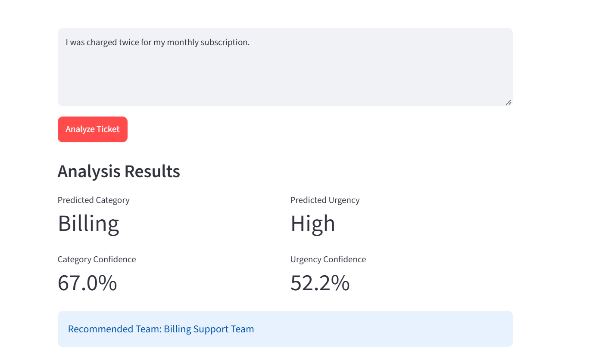

# AI Customer Support Ticket Triage

An AI-powered machine learning application that automatically classifies customer support tickets, predicts urgency, and recommends the appropriate support team.

## 📌 Project Overview

AI Customer Support Ticket Triage is a machine learning project designed to help organize customer support requests efficiently.

The application analyzes ticket text and predicts its category and urgency. It also recommends a suitable support team, displays prediction confidence scores, and flags uncertain predictions for human review.

The project uses Natural Language Processing (NLP) techniques and machine learning algorithms to demonstrate how AI can assist customer support teams.

## ✨ Features

* **Ticket Classification:** Classifies tickets into Billing, Account, Technical, and Product categories.
* **Urgency Prediction:** Predicts Low, Medium, or High urgency.
* **Support Team Recommendation:** Recommends a support team based on the predicted category.
* **Confidence Scores:** Displays estimated confidence for category and urgency predictions.
* **Human Review Alerts:** Flags predictions when either confidence score falls below the configured threshold.
* **Interactive Web Application:** Provides a simple interface built using Streamlit.
* **Input Validation:** Warns users when they submit an empty ticket.
* **Model Evaluation:** Calculates accuracy, precision, recall, and F1-score.
* **Confusion Matrices:** Visualizes model classification results.

## 📸 Application Screenshot

The application analyzes customer support tickets and displays predictions, confidence scores, and review recommendations.



## 🛠️ Technologies Used

* **Python** — Main programming language
* **Pandas** — Dataset handling and analysis
* **Scikit-learn** — Machine learning and model evaluation
* **TF-IDF Vectorization** — Converts ticket text into numerical features
* **Logistic Regression** — Classification algorithm
* **Joblib** — Saving and loading trained models
* **Streamlit** — Interactive web application
* **Matplotlib** — Confusion matrix visualization

## 📂 Project Structure

```text
AI-Customer-Support-Ticket-Triage/
├── data/
│   └── tickets.csv
├── docs/
│   └── screenshots/
│       └── ticket-analysis.png
├── models/
│   ├── category_evaluation.txt
│   ├── urgency_evaluation.txt
│   ├── confusion_matrix.png
│   └── urgency_confusion_matrix.png
├── src/
│   ├── prepare_data.py
│   ├── expand_dataset.py
│   ├── train_category_model.py
│   ├── train_urgency_model.py
│   ├── predict.py
│   ├── ticket_triage.py
│   └── app.py
├── requirements.txt
├── .gitignore
└── README.md
```

The trained `.joblib` model files are generated by the training scripts and may be excluded from Git tracking by `.gitignore`.

## ⚙️ Installation and Setup

### 1. Clone the repository

```bash
git clone https://github.com/ruthikakv/AI-Customer-Support-Ticket-Triage.git
```

Navigate to the project directory:

```bash
cd AI-Customer-Support-Ticket-Triage
```

### 2. Create a virtual environment

```bash
python -m venv .venv
```

Activate it in Windows PowerShell:

```powershell
.\.venv\Scripts\Activate.ps1
```

### 3. Install dependencies

```bash
pip install -r requirements.txt
```

### 4. Train the models

Generate the category model:

```bash
python src/train_category_model.py
```

Generate the urgency model:

```bash
python src/train_urgency_model.py
```

These scripts train the models, evaluate their performance, and save the resulting model files and evaluation reports.

### 5. Run the application

```bash
python -m streamlit run src/app.py
```

Open the local URL displayed in the terminal to access the application in your browser.

## 🤖 How It Works

1. The user enters a customer support ticket.
2. The TF-IDF vectorizer converts the ticket text into numerical features.
3. The category model predicts whether the ticket relates to Billing, Account, Technical, or Product.
4. The urgency model predicts Low, Medium, or High urgency.
5. The application recommends the appropriate support team.
6. Confidence scores are displayed for both predictions.
7. A human-review warning appears when either prediction falls below the configured confidence threshold.

## 📊 Dataset

The project currently uses a dataset of **178 labeled customer support tickets**.

Each record contains:

* Ticket ID
* Ticket text
* Category
* Urgency

The dataset contains four categories: Billing, Account, Technical, and Product.

Urgency is classified into three levels: Low, Medium, and High.

The dataset is intended for learning and prototyping. More diverse, realistic, independently labeled tickets are needed to assess how well the models generalize to real customer support scenarios.

## 📈 Model Evaluation

Both models use a TF-IDF vectorizer and Logistic Regression classifier. Evaluation is performed on a stratified test split containing 36 tickets.

### Category Model

| Metric          |  Result |
| --------------- | ------: |
| Accuracy        | 100.00% |
| Macro Precision | 100.00% |
| Macro Recall    | 100.00% |
| Macro F1-score  | 100.00% |

### Urgency Model

| Metric          | Result |
| --------------- | -----: |
| Accuracy        | 61.11% |
| Macro Precision | 66.84% |
| Macro Recall    | 61.64% |
| Macro F1-score  | 63.40% |

Confusion matrices are generated during training to help analyze the models' predictions.

**Important:** These are preliminary results from a relatively small dataset. The category model's perfect test score does not establish real-world reliability, and the urgency model requires further improvement. Evaluation on larger, independent datasets is needed.

## ⚠️ Limitations

* The dataset is relatively small.
* The models may perform poorly on unfamiliar ticket wording or situations not represented in the training data.
* Confidence scores are estimates, not guarantees of correctness.
* Urgency predictions may be incorrect and should not replace human judgment.
* Human review is important for urgent, uncertain, or sensitive tickets.

## 🚀 Future Enhancements

* Expand the dataset with diverse, realistic support tickets.
* Improve urgency classification performance.
* Evaluate models on larger, independent datasets.
* Add ticket history and a searchable ticket dashboard.
* Store tickets and predictions in a database.
* Add authentication and role-based access for support staff.
* Improve model monitoring and human-review workflows.
* Deploy the application online.

## 👩‍💻 Author

Developed as a machine learning project to explore automated customer support ticket classification, urgency prediction, and support team recommendation.
